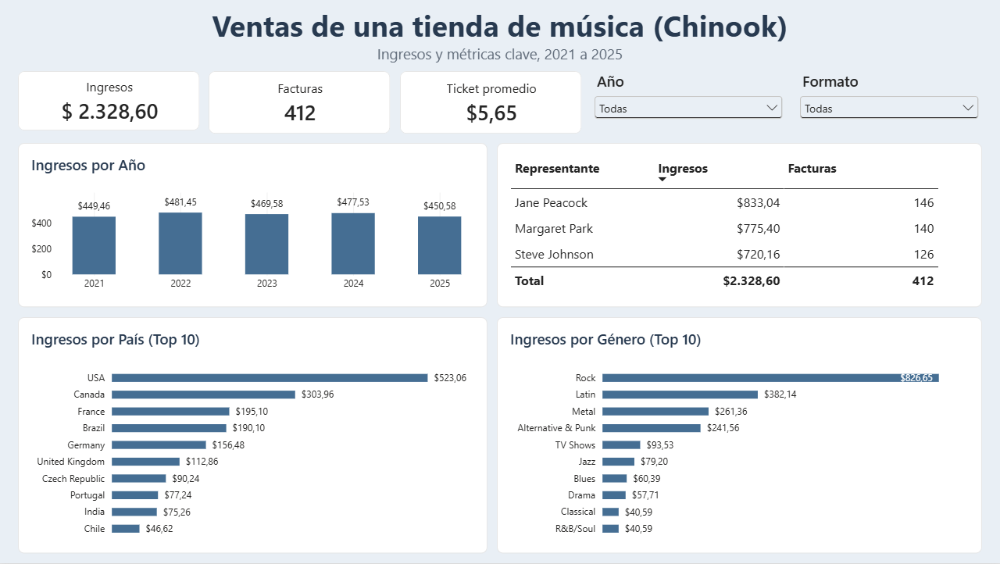

# Tablero de ventas en Power BI (Chinook)

Tablero interactivo de una página sobre las ventas de una tienda de música digital (base de datos **Chinook**). Muestra ingresos, facturas y ticket promedio, y los desglosa por año, país, género y representante de soporte. Complementa el [análisis en SQL y Python](https://github.com/santiagobapr-coder/analisis-ventas-chinook-sql-python), que usa los mismos datos.



## Archivos

| Archivo | Contenido |
|---|---|
| `tablero_ventas_chinook.pbix` | Informe de Power BI Desktop |
| `tablero_ventas_chinook.png` | Captura del tablero |
| `ventas_chinook.sql` | Consulta que genera la tabla de datos usada en el tablero |

## Preguntas que responde

1. ¿Cuánto se vende en total y cuál es el ticket promedio por factura?
2. ¿Cómo evolucionan los ingresos por año?
3. ¿Qué países y géneros musicales concentran los ingresos?
4. ¿Cuántos ingresos y facturas atiende cada representante de soporte?
5. ¿Cambia el panorama según el año o el formato del archivo? (segmentadores)

## Datos

- Fuente: [Chinook Database](https://github.com/lerocha/chinook-database) (versión SQLite).
- Se construyó una tabla única con una línea por cada línea de factura (2.240 filas), uniendo facturas, clientes, representantes, canciones, artistas, géneros y formatos. La consulta está en `ventas_chinook.sql`.
- Periodo: 2021-01-01 a 2025-12-22.

## Preparación en Power Query

- Importación del CSV y revisión de tipos de datos (fecha, enteros y decimales).
- Eliminación de duplicados por `LineaId`.
- Corrección de decimales: al importar con configuración regional en español, el punto decimal de `PrecioUnitario` e `Ingreso` se interpretó como separador de miles y los valores quedaron multiplicados por 100. Se corrigió dividiendo ambas columnas por 100 y se validó contra el total esperado (US$ 2.328,60).

## Modelo

Tabla `Ventas` (hechos) y tabla `Calendario` creada con DAX, relacionadas por fecha (uno a varios) y marcada como tabla de fechas.

```
Calendario = CALENDAR ( MIN ( Ventas[Fecha] ), MAX ( Ventas[Fecha] ) )
```

## Medidas DAX

```
Ingresos = SUM ( Ventas[Ingreso] )
Unidades = SUM ( Ventas[Cantidad] )
Facturas = DISTINCTCOUNT ( Ventas[FacturaId] )
Ticket promedio = DIVIDE ( [Ingresos], [Facturas] )
Ingresos año anterior = CALCULATE ( [Ingresos], DATEADD ( Calendario[Date], -1, YEAR ) )
Crecimiento % = DIVIDE ( [Ingresos] - [Ingresos año anterior], [Ingresos año anterior] )
% del total = DIVIDE ( [Ingresos], CALCULATE ( [Ingresos], ALL ( Ventas ) ) )
```

## Visualizaciones

- Tres tarjetas: Ingresos, Facturas y Ticket promedio.
- Columnas: ingresos por año.
- Tabla: ingresos y facturas por representante.
- Barras: ingresos por país y por género (top 10).
- Segmentadores: año y formato de archivo.

## Validación

Las cifras del tablero coinciden con las del [análisis en SQL](https://github.com/santiagobapr-coder/analisis-ventas-chinook-sql-python):

| Año | Ingresos (USD) |
|---|---|
| 2021 | 449,46 |
| 2022 | 481,45 |
| 2023 | 469,58 |
| 2024 | 477,53 |
| 2025 | 450,58 |

Total: **US$ 2.328,60** en **412** facturas, con un ticket promedio de **US$ 5,65**.

## Cómo abrirlo

1. Descargar `tablero_ventas_chinook.pbix`.
2. Abrirlo con [Power BI Desktop](https://powerbi.microsoft.com/desktop/) (gratuito).
